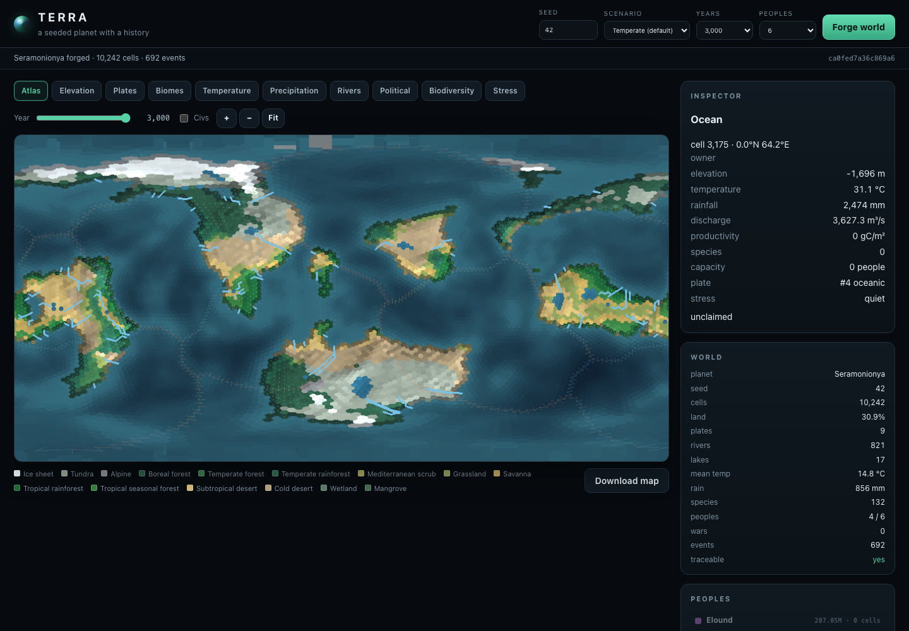

# Terra

**A seeded planet with a history.**

Terra grows an icosphere world from a single seed: plates drift and collide,
mountains rise and erode, rivers cut toward the sea, climate paints biomes,
ecosystems settle in, and rule-based civilizations found cities, trade, fight
and fall. Every event in the chronicle records what caused it, and the whole run
replays from its seed.

Terra is a local, browser-based world simulator written in Rust with **no
external crates**. The client is original HTML, CSS and JavaScript embedded in
the binary. Nothing is fetched from the network.



## Quick start

```sh
cargo run --release -p terra-studio
```

The launcher binds an HTTP/SSE server to `127.0.0.1` on a free port, generates a
random auth token, opens the authenticated URL in your browser, and waits. There
is no terminal workflow after that: the Studio is the product.

Headless reproduction for tests, benchmarks and deterministic seed runs:

```sh
# one JSON report, no server, no browser
cargo run --release -p terra-studio -- --report --seed 42 --years 10000

# generate twice and compare world and chronicle hashes
cargo run --release -p terra-studio -- --verify --seed 42 --years 10000

# run a scenario file
cargo run --release -p terra-studio -- --scenario examples/scenarios/arid.terra --report

# validate a scenario and print its canonical form
cargo run --release -p terra-studio -- --validate-scenario examples/scenarios/micro.terra
```

## What it does

1. **Sphere** — a level-5 icosphere with 10,242 cells, sorted adjacency and
   spherical areas.
2. **Tectonics** — farthest-point plate seeds, contiguous graph Voronoi
   partitions, angular plate motion, convergent/divergent/transform margins,
   subduction, trenches, volcanic arcs and orogenic uplift.
3. **Hydrology** — Priority-Flood depression filling, steepest-descent drainage,
   stream-power erosion, mass-conserving hillslope diffusion, sediment routing,
   lakes with spill points and river-mouth deltas.
4. **Climate** — zonal winds, Ekman-like currents, latitude/altitude/ocean/
   continentality temperature, synchronous moisture advection, orographic lift,
   rain shadows, ITCZ and subtropical dry belts.
5. **Biosphere** — Whittaker-like biomes, connected patches, Miami-model
   productivity, species richness, fragility and human carrying capacity.
6. **History** — growth, expansion, resources, technology, trade, diplomacy,
   war, battles, city capture, famine, epidemics, migration and collapse.
7. **Chronicle** — an append-only store where every event cites measured state
   or earlier events. Chains are acyclic, bounded and inspectable.
8. **Studio** — ten map layers, political year scrubbing, cell inspection, a
   searchable timeline, cause tracing and PNG/Markdown/JSON/CSV exports.

## Guarantees

- **Deterministic.** The same seed and scenario produce the same world and the
  same chronicle hashes. Ten seeds are replayed twice by the acceptance suite.
  See [docs/DETERMINISM.md](docs/DETERMINISM.md).
- **Traceable.** Every chronicle event has a cause chain ending in physical or
  social state. A history whose chronicle fails validation is never served. See
  [docs/CHRONICLE.md](docs/CHRONICLE.md).
- **Bounded.** Every parser enforces hard size, depth and length limits.
  Simulations cap years, cells, civilizations, events and snapshots. Malformed
  input returns errors instead of panicking.
- **Offline.** Standard library only. No runtime downloads, no CDN, no external
  fonts or map tiles. The UI, renderer, PNG encoder, JSON parser and HTTP server
  are original code in this repository.

## Project shape

| Crate | Responsibility |
|---|---|
| `terra-core` | Sphere, tectonics, terrain, hydrology, climate, biomes, ecosystems, scenarios, world assembly |
| `terra-history` | Civilizations, diplomacy, war, collapse, chronicle, causal queries, exports |
| `terra-studio` | HTTP/SSE server, JSON, PNG encoder, map renderer, embedded client, launcher |
| `fuzz` | Deterministic malformed-input campaign (std only) |
| `bench` | Measured timing harness (std only) |

Supporting material:

- [PLAN.md](PLAN.md) and [REQUIREMENTS.md](REQUIREMENTS.md) — the brief.
- [docs/SIMULATION.md](docs/SIMULATION.md) — pipeline and equations.
- [docs/CHRONICLE.md](docs/CHRONICLE.md) — event schema and causality.
- [docs/STUDIO.md](docs/STUDIO.md) — the product and its security model.
- [docs/API.md](docs/API.md) — HTTP/SSE endpoints and limits.
- [docs/DETERMINISM.md](docs/DETERMINISM.md) — streams, hashes, replay.
- [docs/TESTING.md](docs/TESTING.md) — suite and acceptance mapping.
- [docs/PERFORMANCE.md](docs/PERFORMANCE.md) — measured benchmarks.
- [docs/SCENARIOS.md](docs/SCENARIOS.md) — scenario format.
- [LIMITATIONS.md](LIMITATIONS.md) — what is approximate, and why.
- [FINAL_REPORT.md](FINAL_REPORT.md) — LOC, commits, tests, benchmarks, gaps.

## Studio tour

- Forge a world from a seed, an optional preset, a historical span and an
  initial number of peoples.
- Switch between Atlas, Elevation, Plates, Biomes, Temperature, Precipitation,
  Rivers, Political, Biodiversity and Stress.
- Scrub the political year to watch settlement, borders, cities and collapses.
- Click a cell for biome, climate, discharge, species, carrying capacity, plate,
  stress, owner and local events.
- Filter the chronicle by kind, people, text and year range; click an event to
  see direct causes, a breadth-first causal chain, paths to state facts and
  later consequences.
- Export the map as PNG and the chronicle as Markdown, JSON or CSV, or the world
  summary as JSON.

## Performance (measured)

On the development machine, release build, medians from `cargo run --release -p
terra-bench`:

| Workload | Median |
|---|---:|
| World generation, 10,242 cells | 95 ms |
| 10,000-year history, 10,242 cells | 4 ms |
| 1024×512 map layer | 123–133 ms |
| PNG encode 1024×512 | 34 ms |

Full table and methodology in [docs/PERFORMANCE.md](docs/PERFORMANCE.md).

## Development

```sh
make check       # cargo build --workspace --all-targets
make test        # debug tests
make test-rel    # release tests
make fuzz        # malformed-input campaign
make bench       # timing harness
make studio      # launch the Studio
```

The Studio end-to-end test uses Playwright (development-only):

```sh
cargo build --release
python3 tests/studio/test_studio.py
```

No CI is configured, by design. Every slice is committed with a green build.

## License

MIT. See [LICENSE](LICENSE).
